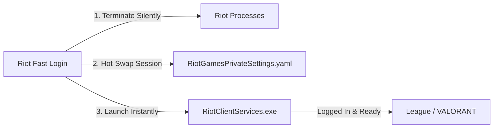

<div align="center">

# ⚡ Riot Fast Login

**Ultra-fast, native Win32 OLED Dark Mode instant login & account switcher for Riot Games (League of Legends, VALORANT, TFT) written in pure Rust.**

[](https://www.rust-lang.org/)
[](https://www.microsoft.com/windows)
[](LICENSE)
[](dist/RiotFastLogin.exe)
[](https://github.com)

<p align="center">
  <b>Instant session swapping • Zero 2FA prompts • 100% OLED Dark Mode • System Tray • Super-Headless</b>
</p>

[English](#-english) | [العربية](#-باللغة-العربية)

</div>

---

## 🌟 Highlights



- ⚡ **Zero 2FA Re-prompts**: Bypasses two-factor authentication and credential re-entry by swapping authenticated local Riot session snapshots.
- 🖤 **100% OLED Dark Fusion UI**: Premium iOS / Riot Client aesthetic. Frameless borderless native Win32 window with deep charcoal `#101010` background, smooth drop shadows, and anti-aliased vector glyphs.
- 🛡️ **Single-Instance Enforcement**: Like Riot Client, launching the app again never opens duplicate windows—it brings the existing window to the foreground immediately.
- 🗂️ **Taskbar System Tray Mode**: Minimizes cleanly to the notification area (`—`). Click to restore, or right-click for a fast context menu.
- 🥷 **Super-Headless Operations**: All background kills and launches use `CREATE_NO_WINDOW = 0x08000000`. Zero black CMD console window flashes.
- 🔄 **Auto-Session Detection**: Log into a new account in Riot Client, and the switcher detects and auto-saves it silently in the background.
- 🖼️ **Official Summoner Icons**: High-resolution 32-bit true-color avatar icons for each account.
- 🚀 **Blazing Fast & Featherweight**: Pure native Win32 GDI. No Electron, no WebView, no Chromium bloat. **< 10 MB RAM footprint** and **< 800 KB binary size**.

---

# 🇬🇧 English

## 📥 Installation

### Option 1: Pre-built Binary (Recommended)
1. Download the latest `RiotAccountSwitcher.exe` from the [Releases](https://github.com) tab or grab it from the `dist/` directory.
2. Run `RiotAccountSwitcher.exe` anywhere (Standalone executable, zero installation required).
3. (Optional) Right-click and create a desktop shortcut.

### Option 2: Build from Source
Requirements: [Rust](https://rustup.rs/) (1.70+ recommended).

```powershell
# Clone the repository
git clone https://github.com/yourusername/riot-account-switcher.git
cd riot-account-switcher

# Build optimized release binary
.\scripts\build.bat
# or via PowerShell
.\scripts\build.ps1 -NoPause
```
The output binary will be generated at `dist/RiotAccountSwitcher.exe`.

---

## 🎮 How to Use

### Graphic User Interface (GUI)
1. **Launch**: Open `RiotAccountSwitcher.exe`.
2. **Auto-Link an Account**:
   - Open Riot Client and sign into your account with **"Stay signed in"** checked.
   - The switcher automatically detects the new session and links it with its official Summoner icon.
3. **Switch & Play**:
   - Click any account card (or the circular Play button) to switch and launch instantly.
4. **Window Controls**:
   - Minimize (`—`): Hides to the System Tray.
   - Close (`✕`): Fully closes the application.
   - Tray Icon: Click to toggle/restore, right-click for quick actions.

### 💻 Command-Line Interface (CLI)
Power users can automate switching via terminal or shortcuts:

```powershell
# List all saved accounts
.\RiotAccountSwitcher.exe --list

# Show currently active logged-in account
.\RiotFastLogin.exe --status

# Save active Riot session
.\RiotFastLogin.exe --save

# Switch to account by index or ID and launch
.\RiotFastLogin.exe --switch 1

# Kill all running Riot processes immediately
.\RiotFastLogin.exe --kill
```

---

## 🔒 Security & Privacy

- **No Credential Harvesting**: This switcher **never** reads, requests, or stores your raw passwords or payment info.
- **Local Only**: All data is stored strictly on your local machine in `%APPDATA%\RiotAccountSwitcher`.
- **Zero Network Telemetry**: 100% offline-capable; makes zero external calls to third-party servers.

---

# 🇸🇦 باللغة العربية

## ⚡ نظرة عامة
**Riot Fast Login** برنامج خفيف جداً، فائق السرعة، ومبني بلغة **Rust** لإدارة والتبديل بين عدد لا نهائي من حسابات Riot Games (League of Legends, VALORANT, TFT) بنقرة زر واحدة دون الحاجة لإعادة إدخال كلمات المرور أو أكواد التحقق بخطوتين (2FA) في كل مرة.

### المميزات الرئيسية:
1. **تبديل الجلسات الفوري (Session Hot-Swapping)**:
   - يتخطى التحقق بخطوتين (2FA) طالما الجلسة نشطة.
   - لا يخزن كلمات المرور مطلقاً.
2. **واجهة OLED Dark Mode عصرية**:
   - تصميم فخم بخلفية سواد كامل `#101010` وحواف دائرية بستايل iOS.
   - خط Riot Games الرسمي (`Beaufort for LOL`).
   - أيقونة رايوت سوداء مع القبضة الحمراء الأصلية (`Black Squircle with Riot Red Fist`).
3. **وضع شريط المهام وصينية النظام (System Tray)**:
   - تصغير سلس إلى جوار الساعة (`—`) مع قائمة كليك يمين سريعة.
4. **منع تكرار فتح النوافذ (Single-Instance Mutex)**:
   - عند تشغيل البرنامج وهو مفتوح مسبقاً، يستدعي نفس النافذة فوراً دون فتح نسخ مكررة.
5. **وضع فائق الصمت (Super-Headless)**:
   - إغلاق وتشغيل العمليات في الخلفية عبر `CREATE_NO_WINDOW` دون ظهور أي وميض لنوافذ CMD السوداء.
6. **ربط تلقائي للحسابات الجديدة**:
   - بمجرد تسجيل الدخول في Riot Client، يكتشف البرنامج الحساب ويحفظه تلقائياً.
7. **استهلاك شبه معدوم للموارد**:
   - استهلاك الذاكرة: **أقل من 10 ميجابايت**.
   - حجم الملف: **أقل من 1 ميجابايت**.

---

## 🛠️ البناء من المصدر (Building from Source)

```powershell
# استنساخ المستودع
git clone https://github.com/yourusername/riot-fast-login.git
cd riot-fast-login

# تشغيل سكربت البناء التلقائي
.\scripts\build.bat
```

الملف التنفيذي الناتج يكون في مجلد: `dist\RiotFastLogin.exe`.

---

## 📄 License
This project is licensed under the [MIT License](LICENSE).
Open source, free to use, modify, and distribute.
